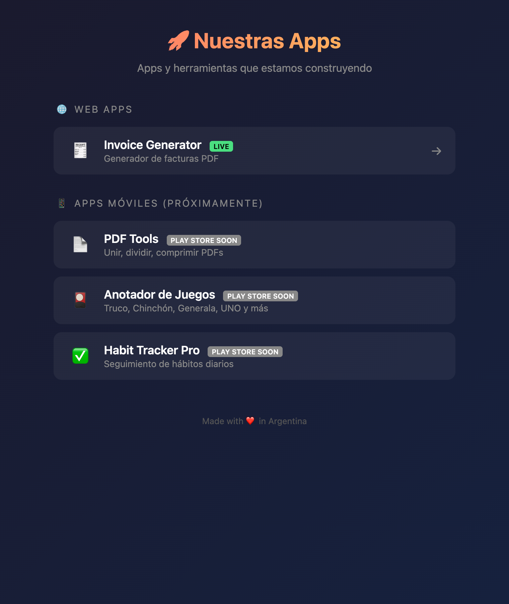

<div align="center">

# 🚀 Apps Landing

**One page that links every app I'm building: what's live today and what's coming next.**

[](https://nico-sanchez.github.io/apps-landing/)
[](https://github.com/Nico-Sanchez/apps-landing/actions/workflows/pages/pages-build-deployment)




</div>

## Apps

### 🌐 Web apps

| App | Description | Link |
| --- | ----------- | ---- |
| 🧾 Invoice Generator | Invoices as PDF | [Open](https://invoice-generator-delta-eight.vercel.app/) |

### 📱 Mobile apps (coming to the Play Store)

| App | Description | Web version |
| --- | ----------- | ----------- |
| 📄 PDF Tools | Merge, split and rotate PDFs | [Open](https://nico-sanchez.github.io/nico-apps-pdf-tools/) · [repo](https://github.com/Nico-Sanchez/nico-apps-pdf-tools) |
| 🎴 Anotador de Juegos | Scorekeeper for Truco, Chinchón, Generala, UNO and more | [Open](https://nico-sanchez.github.io/nico-apps-anotador/) · [repo](https://github.com/Nico-Sanchez/nico-apps-anotador) |
| ✅ Habit Tracker Pro | Daily habit tracking | — |

## Editing

The whole site is a single static `index.html`. Each app is an `<li class="app-item">` with an icon, a name, a description and an optional `badge live` or `badge soon` label. Edit it and push: GitHub Pages publishes the `main` branch.

To preview locally:

```bash
python3 -m http.server 8000
```

Then browse to <http://localhost:8000>.
